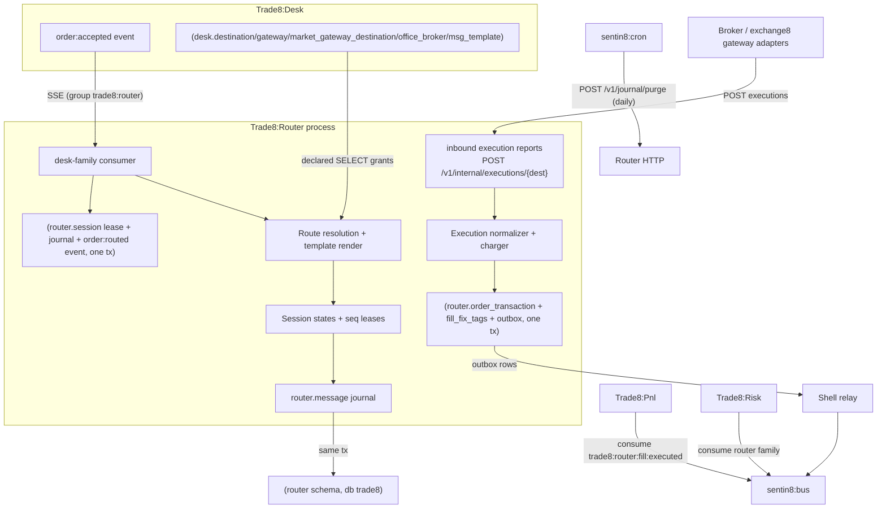

# Trade8:Router - Broker Connectivity Service

> Audience: anyone evaluating or onboarding to the service. For the
> wire-level construction read `DESIGN.md`; for business functionality read
> `BUSINESS.md`. Vertical context: the top-level `DESIGN.md`

> (system map) and `BUSINESS.md` (business view).

## 1. Summary

Trade8:Router owns all outbound broker connectivity. It consumes routed
orders from Trade8:Desk (`trade8:desk:order:accepted`), resolves the
destination route (market → gateway → broker, with office overrides), renders
the outbound message through typed `desk.msg_template` maps or the codec
default, journals every wire message, and normalizes inbound broker
executions (FIX 4.2/4.4 ExecutionReports, OUCH 3.1 inbound messages) into
internal fill events with a full fee breakdown. It is the sole writer of
fills (`router.order_transaction`), preserving broker-dialect FIX tags for
audit.

## 2. Motivation

Broker connectivity concentrates three painful requirements:

- **Per-destination state that must never corrupt.** Sequence numbers,
  heartbeats, resend windows, and logon state are per-broker-session
  bookkeeping where a lost counter means a rejected logon at the worst
  moment. Router isolates each destination's state and journals every
  message.
- **Broker dialects without bespoke code paths.** Destinations differ in
  protocol (FIX 4.2/4.4, OUCH 3.1), field layout, and fee schedules. Typed
  message templates (JSONB field-source maps) and a fee-formula DSL keep
  those differences as *data*, admin-managed, not code branches.
- **Fills as the platform's financial truth.** PnL, Risk and reporting all
  derive from fills; Router normalizes every broker message into one
  internal event shape with fees, liquidity, and preserved FIX tags - the
  single write point for execution state.

Before the platform, this lived in gateway daemons with per-venue server
rows, config hoisting, and a parallel transaction store. Router collapses it
into one service where destinations are DB rows (secret *references*,
never plaintext) and every fill is an outbox event.

## 3. Architecture & High-Level Design

Shadow destinations (gateway `env_mode = 'shadow'`) render and journal but
never transmit - parity/certification testing without broker impact.

## 4. Key Traits and Data Structures

- **`RouterEngine`** (`core.rs`) - `sessions`, `routes`, `charger` handles;
  `build_new_order` (codec + journal), `observe_inbound` (gap detection).
- **`DestinationLink`** - one destination row as used for routing: protocol,
  sender/target CompIDs, begin string, shadow flag, heartbeat, seq-reset
  policy (loaded from Desk's schema via declared grants).
- **`RouteTable`** - market → destination priority list plus office→broker
  overrides; `resolve(market, office)`.
- **`SessionState`** - per-destination out/in sequence numbers, logon state,
  heartbeat mark, journal tail; `next_out_seq` (daily rollover resets),
  `observe_in_seq` → resend window.
- **`Charger`** + `FeeFormula` (`PerShare` / `PerOrder` / `PercentNotional` /
  `Banded`) - the fee DSL evaluated at fill-normalization time.
- **`MsgTemplate` / `TemplateField` / `TemplateSource`** (`wiring.rs`) -
  typed, versioned outbound message templates rendered onto an
  `OrderContext` (const / order-field / config value sources).
- **Codecs** - `trade8::fix` (FIX 4.2/4.4 client-role session + order entry)
  and `trade8::ouch` (OUCH 3.1 client-role) render/parse the wire.

## 5. Rationale, Trade-offs, and Alternatives

- **One consumer group + per-destination sessions rather than per-destination
  tasks with TCP dials (current target state).** The consumer path is
  complete (resolve → render → journal → routed event); live TCP/TLS socket
  shards per destination (exchange8 gateway adapter pattern for HTTP
  destinations is present in `deliver_http`) are the socket-transport
  remainder for FIX/OUCH-native dial-out. Rejected: one global session task
  (head-of-line blocking across brokers).
- **Templates as typed data, not string substitution.** The old free-text +
  regex approach breaks silently on field drift. Typed field-source maps are
  validated at parse and rendered deterministically; versioned rows allow
  staged broker cutover. Rejected: per-destination code builders only
  (inflexible for broker quirks) or raw config (unvalidated).
- **Fees as a formula DSL with hand-verified differential tests.** The four
  formula kinds cover observed fee schedules; conditions and bands are
  explicit. Rejected: embedding a full expression language (unsafe surface,
  overkill), or hardcoding fee math per destination.
- **Fills authored only by Router.** `router.order_transaction` and
  `router.fill_fix_tags` were relocated from Desk: one writer per financial
  record; desk learns of fills through events. Rejected: dual-written fill
  tables (the classic divergence this platform exists to remove).
- **Mimalloc allocator** (master design §11) - steady low latency on the
  journal/normalize path.

## 6. Internal Implementation & Invariants (Private Design)

**Invariants** (unit + `tests/sql_matrix.rs`):

- Every outbound message is journaled (`router.message`, direction out) in
  the same transaction as the session lease and (for accepted orders) the
  `trade8:desk:order:routed` event - journal and state cannot diverge.
- Outbound sequence leases are atomic `UPDATE ... RETURNING` on
  `router.session`; two concurrent orders for one destination get disjoint
  sequence numbers.
- Shadow destinations never send: delivery is skipped when the gateway is
  not in live mode (journals keep the mirror).
- Every inbound execution normalizes to exactly one fill event; corrections
  map to `fill:executed` with the corrected quantities; fills are persisted
  with their fee breakdown and preserved broker FIX tags in one tx with the
  outbox row.
- Heartbeat watchdog marks sessions down after a stale interval - the state
  machine (down/connecting/logged_in) is DB-backed, so restarts resume.
- RLS context + explicit env filters on every router query; cross-schema
  reads are only the five declared desk catalog tables.
- The daily journal purge (Cron `POST /v1/journal/purge`, 30-day retention)
  runs server-side (SQL delete by age), never client-side.

## 7. Unresolved Questions / Future Designs

- **Native FIX/OUCH TCP socket shards** - handshake, heartbeat frames, and
  reconnect/backoff against the codecs are designed (session state machines,
  resend windows all-tested); dial-out wiring to live broker endpoints is
  the remaining socket-transport work.
- **Resend/recovery ring** - the journal is the durability layer; resend on
  reconnect replays from `router.message` (design §4.1) - the replay
  driver is not yet exercised end-to-end against a live session.
- **Template validation surfacing** - admin template viewer exists; the
  validation-results page (render dry-runs against sample orders) is a
  natural follow-up.
- **Exchange8 adapter framing** - HTTP delivery exists; the binary gateway
  protocol adapter (stream bytes vs HTTP octets) needs the venue-side
  contract to finalize.

---

**Architecture & Design:** trade8:router and its underlying concepts were designed by [Hamid Jahanzad](https://www.linkedin.com/in/hamidjahanzad/).
